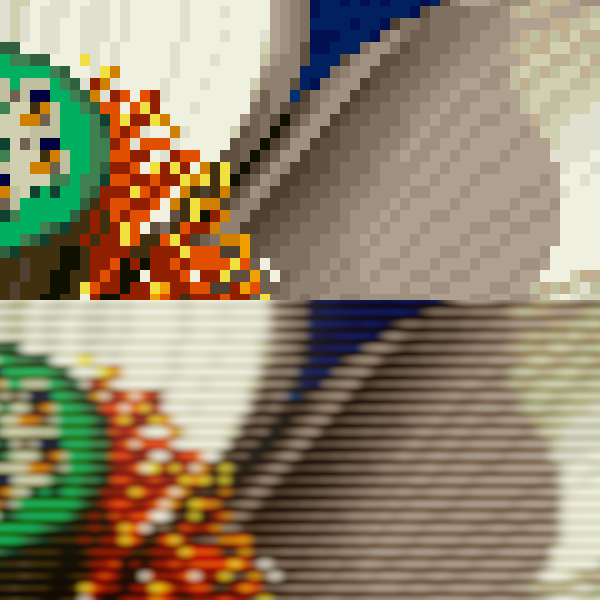

# crt-beans

This is a work-in-progress CRT simulation, prototyped in [Taichi](https://www.taichi-lang.org/) and implemented as a set of [Slang shaders](https://github.com/libretro/slang-shaders) for [RetroArch](https://github.com/libretro/RetroArch) or [librashader](https://github.com/SnowflakePowered/librashader)-compatible software.

||
|---|
|_Detail from [Jim Sachs'](https://amiga.lychesis.net/artists/JimSachs.html) lotus artwork, originally on the "Amiga Dealer" demo. The top is a simple nearest neighbor upscale, and the bottom is generated by the Taichi simulation._|

The original goal for this project was to accurately simulate the scanline-based raster drawing of a CRT television. Scanlines are simulated in (what I believe is) a novel way, which results in consistent and accurate results regardless of the horizontal input resolution or the output resolution.

There are many highly configurable shaders offering more features than this one. The features and configurable parameters will be kept limited for the sake of simplicity in use and development. The goal is to make pixel art look good, not to accurately simulate any arbitrary CRT television.

## Supported features

Currently, supported features include:
* A configurable low-pass filter to simulate the limited bandwidth of an analog connection.
* Optional YIQ encoding to simulate a composite or s-video connection (actual NTSC encoding/decoding is not currently supported).
* Configurable scanline simulation.
* Configurable overscan cropping.
* "Glow" simulation, recreating the glowing areas around bright parts of the screen caused by the scattering of light in the glass.
* Interlacing support in the Slang shaders.
* Support for aperture gille masks, either with predefined subpixel layouts or dynamically generated.
* The Slang shaders have been tested to run in 4k at 60 FPS on a Ryzen 7000 integrated GPU in their default configuration. _Performance is a feature!_

## Benchmarking shader presets

`benchmark_shader.py` benchmarks one preset and a shader-disabled baseline using
Flatpak RetroArch's built-in image viewer. It starts a private headless Weston
display and renders at **2880×2160** by default, preserving the image's native input size.
Use `--output-resolution WIDTH HEIGHT` to select another output size.
Install `weston` (on Fedora: `sudo dnf install weston`) and the RetroArch Flatpak,
and run from a user session with `XDG_RUNTIME_DIR` and access to a hardware Vulkan
GPU. No monitor or visible RetroArch window is required.

```sh
uv run python benchmark_shader.py slang-shaders/crt-beans-ntsc.slangp test-images/snes-mmx.png
```

The harness saves its configuration, verbose logs, validation screenshots and
`results.json` in a new directory under `/tmp`. Use `--output-dir PATH` to retain
them in a chosen new directory. The user's RetroArch configuration is not loaded.
The preset is read in place, so referenced presets, includes and textures retain
their original paths.

Each workload first runs 600 warm-up frames and takes an untimed GPU screenshot
to check the output dimensions. It then measures five pairs of 1,000-frame and
7,000-frame runs, alternating short/long order. Frame time is estimated as
`1000 × (long_seconds − short_seconds) / 6000` milliseconds, reducing fixed
startup/compilation overhead. Results include the raw runs, median frame time,
FPS, range and median absolute deviation. This measures RetroArch throughput,
including presentation, rather than individual shader pass GPU time.

Software rendering, shader errors/fallback, unexpected output dimensions and
FIFO presentation are rejected. A baseline at or below 65 FPS is also rejected
as potentially capped. Logs use RetroArch 1.22.2's Vulkan messages; an unrecognized
backend/log format fails validation rather than silently accepting a result.
For the initial swapchain RetroArch reports supported modes instead of the
selected mode; the harness records its mode inference with VSync disabled.
Artifacts survive failures, timeouts and interruption, and the harness stops its
own compositor and active rendering process. Timed runs do not take screenshots.
Keep other GPU workloads idle when comparing results.

`--short-frames`, `--long-frames`, `--warmup-frames`, `--repeats`, `--timeout` and
`--gpu-index` control run length and device selection; see `--help`. Small frame
counts are useful for a smoke test but produce noisy benchmark estimates.
